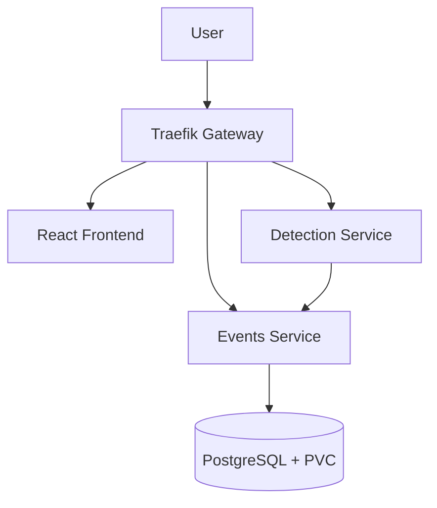

# cyberwatch-cloud-native
Cloud-native cybersecurity monitoring platform using microservices, REST APIs, Docker and Kubernetes.
# 🛡️ CyberWatch
### Cloud-Native Security Monitoring Platform

A cybersecurity monitoring application built with **Spring Boot, React, Docker, and Kubernetes**.

CyberWatch allows users to record security events, detect failed login attempts, and visualize security alerts through a web dashboard.

## ✨ Features

- **Security Events** — Create and store security events.
- **Threat Detection** — Detect failed login attempts automatically.
- **Dashboard** — Visualize events and alerts through a React interface.
- **Persistent Storage** — Store events in PostgreSQL.
- **Cloud-Native Architecture** — Deploy independent microservices on Kubernetes.

## 🏗️ Architecture



## 🛠️ Tech Stack

| Category | Technologies |
|---|---|
| Frontend | React, Vite, Nginx |
| Backend | Java 21, Spring Boot, REST APIs |
| Database | PostgreSQL 17 |
| Containerization | Docker, Docker Hub |
| Orchestration | Kubernetes, Minikube |
| API Gateway | Traefik |
| Security | RBAC, NetworkPolicy, Secrets, SecurityContext |

## 🚀 Getting Started

**Prerequisites:** Docker, Minikube, Helm.

```powershell
git clone https://github.com/sislem404/cyberwatch-cloud-native.git
cd cyberwatch-cloud-native
minikube start --driver=docker
```

Install Traefik:

```powershell
helm repo add traefik https://traefik.github.io/charts
helm repo update
helm install traefik traefik/traefik --namespace traefik --create-namespace
```

Create the PostgreSQL Secret and deploy:

```powershell
minikube kubectl -- create secret generic postgres-secret --from-literal=POSTGRES_PASSWORD="your-password"
minikube kubectl -- apply -f k8s/
minikube kubectl -- get pods
```

Access the application:

```powershell
minikube kubectl -- port-forward service/traefik 8088:80 -n traefik
```

**Dashboard:** http://localhost:8088

## 🔌 REST API

| Method | Endpoint | Description |
|---|---|---|
| GET | `/events` | List security events |
| POST | `/events` | Create a security event |
| GET | `/alerts` | Retrieve detected alerts |

## 🔐 Security

CyberWatch implements several Kubernetes security controls:

- **RBAC** — Read-only access for an auditor ServiceAccount.
- **NetworkPolicy** — Restricts database access to the Events Service.
- **Secrets** — Stores the database password outside the source code.
- **SecurityContext** — Runs application containers without root privileges.

## 📸 Dashboard

*Application screenshot coming soon.*

## 📌 Project Status

 Microservices deployed on Kubernetes  
 API Gateway configured  
 Persistent PostgreSQL storage  
 Kubernetes security controls implemented  

**Academic Cloud Native / DevOps project.**